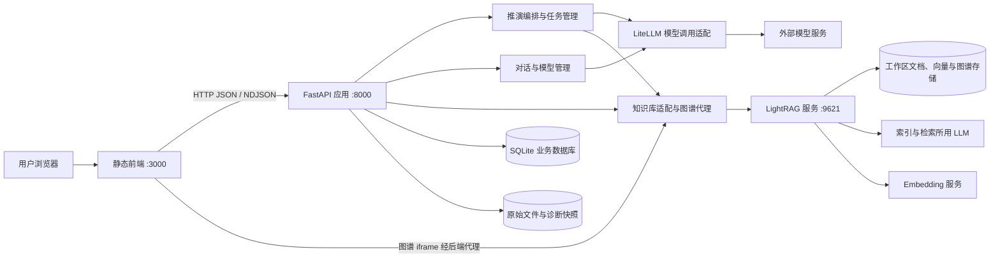
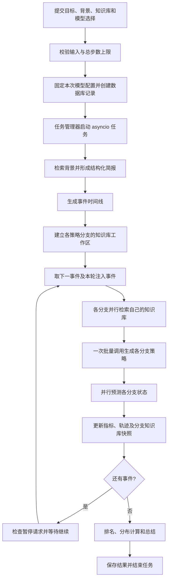
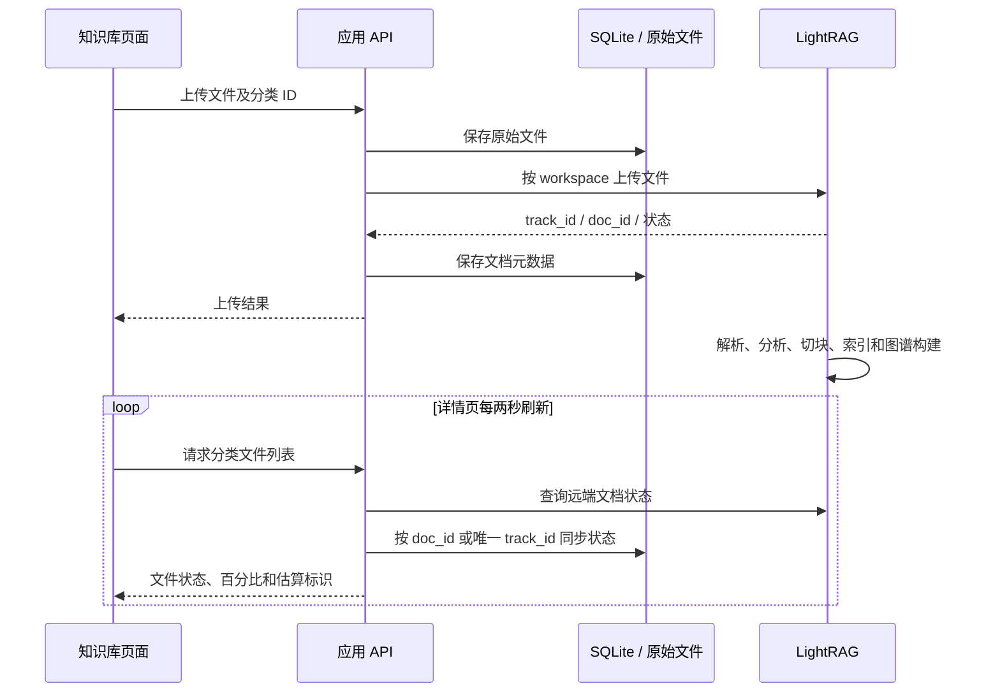

# Odyssey 项目架构说明

> 基于 2026-10-23 仓库代码整理，描述当前实现。安装和启动步骤见 [README](../README.md)。

## 1. 项目定位与总体结构

Odyssey 是一个基于大语言模型和知识库的决策推演应用，后端包名为 PRDS（Parallel Reality Decision Simulator）。用户提供目标和背景，选择参考知识库，系统沿同一条事件时间线推进多条策略分支，再比较各分支的指标变化、决策轨迹及最终结果。

每条分支代表一种决策档案，而不是独立训练的模型；分支之间通过不同的策略、当前状态及知识库工作区保持差异。应用还提供独立对话、文档管理和图谱浏览。

系统采用“静态前端＋应用 API＋独立 LightRAG 服务”的结构，标准启动面向本机单用户使用。



| 组件 | 技术 | 主要职责 |
| --- | --- | --- |
| 主前端 | 原生 JavaScript ES Modules、HTML、Tailwind CSS、自定义 CSS | 推演页面、知识库、对话、设置、状态反馈 |
| 应用 API | FastAPI、Pydantic、httpx | 请求校验、业务接口、LightRAG 适配与代理 |
| 推演引擎 | Python asyncio、结构化模型输出 | 事件规划、分支推进、指标计算、结果汇总 |
| 业务持久化 | SQLAlchemy Async、aiosqlite、SQLite | 推演记录、文档元数据、模型设置、对话记录 |
| 知识库服务 | 仓库内定制 LightRAG | 文件解析、内容分析、切块、向量索引、实体关系图谱和检索 |
| 模型适配 | LiteLLM | 应用侧模型路由、请求级凭据和结构化输出重试 |
| 可选图数据库 | Neo4j | 可选存储基础设施；默认文件存储方案不依赖它 |

主前端没有 React/Vue 运行时，也没有 JavaScript 打包构建要求。LightRAG 自带另一套独立 WebUI，需要单独构建，不能与主前端混为一谈。

## 2. 代码分层与模块职责

### 2.1 目录组织

```text
Odyssey/
├── frontend/
│   ├── index.html                 # 页面入口
│   ├── config.js                  # 浏览器使用的应用 API 地址
│   ├── js/
│   │   ├── app.js                 # Hash 路由与页面生命周期
│   │   ├── api.js                 # HTTP 请求与推演状态轮询
│   │   ├── layout.js              # 侧栏、历史列表和公共布局
│   │   ├── pages/                 # 推演、对话、知识库和设置界面
│   │   └── i18n.js / prefs.js     # 文案与浏览器偏好
│   └── css/                       # Tailwind 产物与主题样式
├── backend/
│   ├── src/prds/
│   │   ├── main.py                # FastAPI 入口与应用生命周期
│   │   ├── config.py              # 环境变量及运行时模型覆盖配置
│   │   ├── api/                   # 推演、对话、模型接口
│   │   ├── models/domain.py       # 输入、事件、分支、状态和结果模型
│   │   ├── kbsim/                 # 知识库驱动的推演流水线
│   │   ├── simulation/            # 任务所有权、暂停控制和公开错误
│   │   ├── llm/                   # 模型请求、provider 适配和 JSON 校验
│   │   ├── kb/                    # LightRAG 客户端、配置同步和代理
│   │   └── storage/               # ORM、数据库迁移与读写
│   ├── LightRAG/                  # 定制的知识库服务及其 WebUI
│   ├── tests/                     # 应用后端回归测试
│   └── data/                      # 本机运行数据，不作为源码管理
├── scripts/                       # 启动和停止脚本
├── docs/                          # 架构说明和示例
└── docker-compose.yml             # 可选 Neo4j，不包含整套应用编排
```

### 2.2 前端页面组织

`app.js` 解析 URL Hash，在页面切换时卸载旧页面的轮询、监听器及知识库弹窗，再渲染和挂载新页面。

| 路由 | 当前用途 |
| --- | --- |
| `#simulate` | 创建推演 |
| `#simulate/<id>` | 在同一工作区查看推演进度、操作任务或查看结果 |
| `#chat`、`#chat/<id>` | 新对话或已有会话 |
| `#kb`、`#kb/<id>` | 知识库分类列表、文件列表和图谱 |
| `#settings`、`#model` | 打开设置弹窗 |

旧的 history、monitor、results 等路由转到推演工作区；对应旧页面文件仍在仓库中，阅读代码时应以 `app.js` 的实际路由为准。对话与推演的部分页面实现共用 `pages/simulate.js`。

`api.js` 集中处理请求。推演进度采用串行轮询，正常间隔为 1.5 秒，超时为 10 秒；连续失败会退避，五次失败后暂停并允许手动重连。知识库文件列表每两秒刷新，避免同一详情页的周期刷新请求重叠。

### 2.3 后端分层

- **接口层**：校验参数和任务状态，协调模型选择、业务存储及任务启动，返回公开模型信息、错误和警告。
- **编排层**：`KbSimOrchestrator` 按顺序执行推演阶段，通过回调保存进度、暂停状态及诊断快照。
- **领域计算层**：生成事件与策略、预测分支状态、计算指标进度、排名和分布，再生成总结。
- **基础设施层**：通过 LiteLLM 调用模型，通过 `LightRAGClient` 操作知识库，通过 Repository 读写 SQLite。

接口入口可从 [main.py](../backend/src/prds/main.py) 追踪；核心推演流程位于 [orchestrator.py](../backend/src/prds/kbsim/orchestrator.py)。

## 3. 推演引擎与任务生命周期

### 3.1 创建和执行流程



具体阶段如下：

1. **输入分析 `intake`**：结合目标、背景和知识库检索结果，生成约束、风险及带有起点和目标值的指标。
2. **事件规划 `event_plan`**：生成有先后顺序的事件；较长的时间线按配置加入少量黑天鹅事件。
3. **分支建立 `branch_fork`**：按策略数量创建分支，分配理性/非理性决策档案并写入初始快照。
4. **分支推演 `branch_sim`**：对同一事件，各分支分别检索、应对和预测，再把新状态反馈到各自知识库。
5. **评分 `scoring`**：依据最终指标计算目标进度并排名；进度相同时以预测置信度作为排序依据。
6. **总结 `synthesis`**：基于轨迹生成决策原则、分歧节点、反事实对照和行动路线。
7. **清理与完成**：根据配置保留或清理分支工作区，保存最终结果。

这里的“评分”主要来自模型预测的指标变化，分支分布也是策略之间的比较，不能解释为经过统计校准的现实成功概率。

### 3.2 分支隔离与状态反馈

通常，每个分支会复制所有选中的源知识库，并把第一个副本作为主要状态写入工作区。各分支可以读取自己的多个副本，但不会把推演状态写回用户原始知识库。

当本机可统计的源知识库体积超过阈值时，系统改用“只读源知识库＋每个分支独立的小型状态工作区”，以减少复制开销。未选择知识库时，也会创建分支状态工作区，因此推演仍依赖 LightRAG 服务。

状态快照按配置定期更新，最后一个事件始终更新。替换快照会先删除旧版本，等待异步删除完成，再插入和索引新版本，以避免旧状态继续影响后续检索。旧快照被替换后，各事件的历史状态仍保留在应用侧决策轨迹中。

### 3.3 暂停、注入、取消与重启

任务状态与执行阶段分别建模：`status` 表达任务是否结束或暂停，`phase` 表达当前执行环节。

| 状态 | 含义 |
| --- | --- |
| `pending` | 已创建，尚未进入执行 |
| `running` | 正在执行 |
| `paused` | 已完成当前事件，等待继续 |
| `completed` | 结果已保存 |
| `failed` | 核心步骤失败，停止执行 |
| `cancelled` | 用户停止任务 |
| `interrupted` | 服务退出或重启导致任务未完成 |

- 暂停只在分支推演阶段可用，在当前事件结束后生效；最后一个事件开始后不再接受暂停。
- 暂停期间添加的事件与下一轮原计划事件一起进入检索、策略、预测、快照及复盘，每个注入事件消费一次。
- 任务管理器保存主任务引用；并行操作由 `gather_owned` 管理，一个子任务失败时取消并等待其他子任务退出。
- 删除任务按“取消并等待退出 → 清理分支图谱 → 删除业务记录”执行；退出超时或清理失败时保留记录供重试。
- 启动时将遗留的 pending、running、paused 记录标记为 interrupted。“重新运行”会创建新任务，保留旧记录，不自动重放途中注入的事件。
- 检查点只保存诊断快照，不具备完整的断点续跑语义。

输入分析、策略、预测及必需知识库操作失败会终止推演。总结失败则保留已算出的结果，并通过结构化警告说明；检索成功但没有相关材料也会提示依据不足。

## 4. 知识库、文件处理与图谱

### 4.1 分类对应工作区

应用中的知识库分类对应 LightRAG 的 workspace。SQLite 保存分类名称、说明、文档归属及跟踪信息，LightRAG 保存解析、索引和图谱数据。



文档保存原始文件是为了支持预览和下载；它与 LightRAG 内部处理输入、解析产物及索引副本是不同的数据层。

### 4.2 文件进度的含义

当前主前端百分比是按真实处理阶段映射的估算，不是按时间递增，也不是精确的逐页或分块完成率。

| 阶段 | 页面百分比 | 性质 |
| --- | --- | --- |
| 等待处理 / 已上传 | 0% | 阶段估算 |
| `parsing` | 15% | 阶段估算 |
| `analyzing` | 40% | 阶段估算 |
| `preprocessed` | 55% | 阶段估算 |
| `processing` | 65% | 阶段估算 |
| `processed` / 完成 | 100% | 已完成 |
| 失败或未知阶段 | 无确定百分比 | 不伪装为完成 |

这些百分比由应用 API 生成，通过 `progress_pct`、`progress_is_estimated`、`processing_stage` 返回。某些文件会跳过部分阶段，百分比不保证逐点连续变化。

### 4.3 图谱访问

主前端用 iframe 加载 LightRAG 的图谱 WebUI，地址经过应用后端的 `/lightrag/...` 代理。浏览器不必在页面中直接使用 LightRAG 的 9621 端口。

代理统一了 LightRAG WebUI 与其 API 的后端访问入口，但默认 3000 端口主前端和 8000 端口应用 API 仍属于不同 origin，需要后端 CORS 配置。图谱界面使用的是 LightRAG 自己构建的前端资源。

## 5. 模型配置与独立对话

### 5.1 两套模型调用链

| 调用链 | 配置入口 | 用途 |
| --- | --- | --- |
| 应用侧 LLM | 页面模型目录、SQLite 设置、`backend/.env` | 输入分析、事件规划、策略、预测、总结及独立对话 |
| LightRAG LLM | `backend/data/lightrag/.env` 的 `LLM_*` | 索引过程中的内容处理、实体关系提取及部分检索处理 |
| LightRAG Embedding | 同一文件的 `EMBEDDING_*` | 文档和查询向量化 |

页面设置会同步部分默认模型参数到 LightRAG 的配置文件，但不会让运行中的独立服务自动重新加载配置。已有 Embedding 配置也需要单独检查，不能把任意对话服务的密钥和地址当作可用的向量服务配置。

LightRAG 自身接口认证所用的 `LIGHTRAG_API_KEY`，与它调用外部模型服务的密钥也是不同概念。

### 5.2 单次推演的模型选择

前端传入 `config.model_id`，后端严格查找目录条目，并固定本次任务的模型、provider、服务地址及密钥配置。使用页面选择的模型时，所有应用侧推演阶段使用该模型；运行中修改默认模型不会改变已有任务。

未提供 model_id 的旧请求继续使用环境和运行时配置，允许旧的决策模型、分析模型覆盖字段。新旧两种选择方式不能同时使用。

`LLMClient` 通过 LiteLLM 发起请求，凭据和服务地址随请求传入。结构化输出会附带 Pydantic JSON Schema，并在调用或 JSON 校验失败时按实现进行有限重试。对外状态和结果仅保存公开模型信息，不包含任务凭据。

### 5.3 对话链路

独立对话不经过推演流水线，也没有自动接入推演的知识库检索上下文。后端读取会话历史，追加用户消息，调用所选模型并保存回答。

流式接口使用 **HTTP StreamingResponse＋逐行 JSON（NDJSON）**，依次发送 meta、delta、done 或 error。它不是 WebSocket，也不是 SSE。前端据此增量显示回答。

## 6. 数据持久化与部署

### 6.1 数据归属

| 位置 / 表 | 保存内容 |
| --- | --- |
| `simulation_runs` | 原始输入、进度、状态、公开模型信息、警告、失败信息及完整结果 JSON |
| `kb_categories`、`kb_documents` | 分类及文档元数据、远端 ID、跟踪 ID、原始文件路径 |
| `app_settings` | 模型目录与运行时设置，包括应用读取所需的密钥 |
| `chat_sessions`、`chat_messages` | 会话信息和历史消息 |
| `backend/data/kb/` | 应用保存的原始上传文件 |
| `backend/data/lightrag/` | LightRAG 配置、输入及工作区索引数据 |
| `backend/data/logs/` | 服务日志及按推演 ID 保存的诊断快照 |
| 浏览器 localStorage / sessionStorage | 语言、主题、默认参数、模型选择和部分导航状态 |
| 后端进程内存 | 活动 asyncio 任务、暂停事件及待注入事件 |

启动脚本以 backend 目录作为应用后端工作目录，默认数据库因此是 `backend/prds.db`。相对数据路径也以该工作目录解析，直接手动启动时应保持这一点。

LightRAG 默认存储后端为 JsonKVStorage、JsonDocStatusStorage、NanoVectorDBStorage 和 NetworkXStorage，具体可由其配置调整。单独启动 Compose 中的 Neo4j 并不意味着 LightRAG 已经自动改用 Neo4j。

当前模型密钥以应用配置数据形式持久化，没有独立的密钥管理服务；公开接口使用掩码或不返回密钥，不能把这等同于数据库中的密钥已经加密。

### 6.2 服务启动与运行边界

`scripts/start.sh` 依次启动 LightRAG、应用 API、静态前端，并等待部分服务就绪；日志写入 backend/data/logs。LightRAG 启动失败时仍会尝试启动应用和前端，因此页面可打开不代表知识库操作一定可用。

| 服务 | 默认监听 |
| --- | --- |
| 主前端 | `127.0.0.1:3000` |
| 应用 API | `127.0.0.1:8000` |
| LightRAG | `127.0.0.1:9621` |
| 可选 Neo4j | 本机 7474 / 7687 |

**应用后端需要单进程运行。** 活动任务与暂停控制保存在进程内存，没有 Redis、外部任务队列或跨进程信号协调。直接增加 Uvicorn workers 会使暂停、继续和取消请求可能落到不拥有任务的进程。

当前版本面向本机单用户，没有完整的账号、权限和按用户隔离机制；工作区隔离服务于知识库和推演分支，不等于用户访问权限隔离。

## 7. 接口与维护入口

| 接口组 | 作用 |
| --- | --- |
| `/api/health`、`/api/config` | 应用健康状态及公开配置；密钥存在不代表模型服务已验证可用 |
| `/api/simulations` | 创建任务和查询历史 |
| `/api/simulations/{id}`、`result` | 查询进度、读取结果和删除记录 |
| `/api/simulations/{id}/pause`、`resume`、`events` | 暂停、继续和注入事件 |
| `/api/simulations/{id}/cancel`、`retry` | 停止任务和创建新的重试任务 |
| `/api/kb/...` | 分类、文档、原始内容和知识库状态 |
| `/api/llm-models`、`/api/llm-settings` | 模型目录、默认模型和兼容设置 |
| `/api/chat/...` | 会话管理、普通回答和 NDJSON 流式回答 |
| `/lightrag/...` | LightRAG WebUI 与 API 代理 |

具体 HTTP 方法及请求模型以运行中的 `http://localhost:8000/docs` 为准。

日常验证入口：

```bash
# 从仓库根目录执行后端测试
cd backend
../.venv/bin/python -m pytest -q

# 在 frontend 目录执行前端轮询测试和文案检查
cd ../frontend
npm test
npm run check:i18n
```

前端浏览器交互验收脚本为 `frontend/scripts/check-simulation-ui.py`，使用受控 API，不调用真实付费模型。后端测试覆盖推演阶段、知识库适配、模型配置、任务取消与重启处理、文档进度和启动监听范围。

若后续需要团队共享或大规模任务，应分别设计用户权限、持久化任务调度、跨进程控制、密钥管理及存储部署，不能只修改监听地址或提高 workers 数量。
